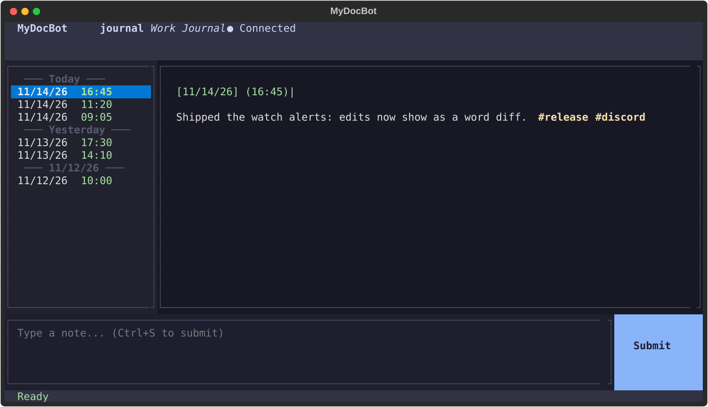

# MyDocBot

[](https://github.com/matrixel-ps/MyDocBot/actions/workflows/ci.yml)
[](LICENSE)


A terminal note-taker that prepends timestamped notes to Google Docs. Write from
a quick one-line command, a line-by-line CLI, or a full-screen TUI. A separate
read-only TUI browses docs in another format, and an optional Discord bot takes
notes by DM and tells you when a watched doc changes.



**Requirements:** Python 3.11 or newer, a Google account, and Linux or macOS.
Windows is untested: there, the cross-process file locking (`fcntl`) is
unavailable, so run only one MyDocBot window or bot at a time.

[CHANGELOG](CHANGELOG.md) · [open work](docs/backlog.md) · [architecture](docs/architecture.md)

---

## Quickstart

- [ ] `git clone https://github.com/matrixel-ps/MyDocBot.git && cd MyDocBot`
- [ ] Enable the Google Docs API and download OAuth credentials ([Setup](#setup))
- [ ] `pipx install -e .` (or `pip install -e .` in a venv)
- [ ] Put `credentials.json` in `~/.config/mydocbot/` (or `$MYDOCBOT_HOME`)
- [ ] `mydocbot --add mynotes <doc_id>`
- [ ] `mydocbot`. The first run opens the Google sign-in in your browser.
- [ ] `mydocbot "a quick note #tag"` writes one note and exits
- [ ] `mydocbot --tui` for the full-screen app; `mydocbot --read` for browsing only

---

## Setup

### 1. Google credentials

MyDocBot talks to Google Docs with your own Google Cloud project and OAuth
client, so nothing goes through anyone else's servers. Setting it up takes
about ten minutes, once. Google renames these menus from time to time; the
[Docs API Python quickstart](https://developers.google.com/workspace/docs/api/quickstart/python)
has the current wording.

1. **Project and API.** In the [Google Cloud Console](https://console.cloud.google.com),
   create a project (any name), then
   [enable the Google Docs API](https://console.cloud.google.com/flows/enableapi?apiid=docs.googleapis.com)
   for it.
2. **Consent screen.** Go to **Menu → Google Auth platform → Branding** and
   click **Get started**:
   - **App information:** any app name (e.g. "MyDocBot") and your email.
   - **Audience:** choose **External**. (**Internal** only exists for Google
     Workspace organizations; a personal Gmail account must use External.)
   - **Contact information:** your email. Agree to the policy and **Create**.
3. **Add yourself as a test user.** **Google Auth platform → Audience → Test
   users → Add users**, and add the Google account whose docs you'll use.
4. **OAuth client.** **Google Auth platform → Clients → Create client**,
   application type **Desktop app**, any name, **Create**. Download the JSON
   and save it as `credentials.json` in the [data directory](#data-directory)
   (`~/.config/mydocbot/` by default), then `chmod 600` it.

**Testing or In production?** A new app is in **Testing**. That's fine for
personal use, but Google expires a test user's sign-in after **7 days**, so
MyDocBot will open the browser to sign in again about once a week. That
matters most for the Discord bot, which runs unattended: once its sign-in
expires, its Google calls fail (notes are queued) until you run `mydocbot` to
sign in again and restart the bot. To avoid it, click **Publish app**
on the **Audience** page. Google then shows a "Google hasn't verified this
app" warning when you sign in (choose **Advanced**, then **Go to** your app's name); that's
expected for an app only you use, and it doesn't need Google's review while
it has fewer than 100 users.

**What MyDocBot can access.** It asks for one permission, the
`https://www.googleapis.com/auth/documents` scope, which Google describes as
seeing, editing, creating and deleting all your Google Docs documents. The
narrower `drive.file` scope only reaches files an app created or opened
through a file picker, so it can't write to an existing doc you give by ID.
In practice MyDocBot only opens the doc IDs you add with `--add` / `/add`,
and the read-only TUI and the Discord watcher never write. The sign-in is
saved in `token.json` in the data directory; revoke it any time at
[myaccount.google.com/connections](https://myaccount.google.com/connections).

### 2. Install

```bash
pipx install -e .                     # global `mydocbot` command (or: uv tool install -e .)
pip install -e .                      # or inside a virtualenv
pip install -r requirements.txt       # exact, tested runtime versions
pip install -r requirements-dev.txt   # plus pytest, ruff, mypy (to run lint.sh)
pipx install -e '.[discord]'          # optional: also the Discord bot (see Discord bot below)
```

`python main.py` works from the repo too, with the same flags. Python 3.11 or
newer is required.

### Data directory

All personal files live in one directory: the first of `$MYDOCBOT_HOME`,
`$XDG_CONFIG_HOME/mydocbot`, or `~/.config/mydocbot`. It is created with
`0700` permissions. If it doesn't exist yet, the first run copies any of those
files from the repo root (where older versions kept them) and lists what it
copied. The originals are left in place; delete them once everything works.
This needs an editable install (`-e`) or `python main.py`; otherwise copy the
files by hand.

| File | Comes from | Holds |
|---|---|---|
| `credentials.json` | You (Google Cloud) | OAuth client |
| `token.json` | First sign-in | Your saved sign-in |
| `docs_config.json` | `--add` / `/add`, or a copy of `docs_config.example.json` | Write-mode doc aliases |
| `read_config.json` | `/add` inside `--read` | Read-only doc aliases (separate list) |
| `tags_index.json` | Each note you write | Local `#tag` index |
| `pending_queue.json` | A write that couldn't be sent | Notes waiting to be written |
| `last_write.json` | Each note you write | The last note written to each doc, for `/undo` |
| `discord_token` | You (Discord Developer Portal) | Bot token, only for the [Discord bot](#discord-bot) |
| `discord_config.json` | You | Discord user IDs the bot obeys; optional docs to watch |
| `watch_state.json` | The bot's watcher | Last seen text of each watched doc (kept so edits can be shown as a diff) |

### 3. Add a document

```bash
mydocbot --add log <google_doc_id>   # the ID is in the URL: docs.google.com/document/d/<ID>/edit
```

Aliases can't contain spaces or start with `/`. You can also copy
`docs_config.example.json` to `docs_config.json` in the data directory and
fill in the ID:

```json
{"default": "log", "aliases": {"log": "YOUR_GOOGLE_DOC_ID"}, "history_size": 20}
```

`history_size` (optional, 1–500, default 20) is how many recent notes a TUI
loads when it opens a doc.

---

## Usage

```bash
mydocbot                     # CLI: type notes line by line
mydocbot --doc work          # CLI on another alias
mydocbot --tui               # full-screen read/write app
mydocbot --read [alias]      # read-only browser (uses read_config.json)
mydocbot --undo              # remove the last note you wrote to the default doc
mydocbot --list              # list aliases and exit
mydocbot --add <alias> <id>  # add an alias and exit
mydocbot-discord             # Discord bot: DM it to write a note (optional extra)
```

### Quick capture

```bash
mydocbot "met with Sam #standup"                 # to the default doc, then exit
mydocbot -d work "call the vendor"               # to another alias
git log -1 --format=%s | mydocbot -d work        # anything piped in becomes the note
```

This writes exactly as the REPL does: validation, offline queueing and tag
indexing. Success prints one line; errors go to stderr. Exit codes: `0` sent,
`1` rejected or config error, `2` usage error, `3` queued (not sent yet).
Piping text in always means "write this note", so you can't drive the REPL
from a pipe.

### Undo the last note

`/undo` (or `mydocbot --undo [-d alias]` from a shell) removes the last note
MyDocBot wrote to a doc, for a typo, the wrong doc or an accidental submit.
It only deletes if the top of the doc is still exactly that note, so it never
removes something written since, by you or anyone else. If the top has
changed, nothing is deleted and you're told. It undoes one note: a second
`/undo` finds nothing. The note's tags leave the index too.

- **It works across sessions:** `mydocbot "oops"` then `mydocbot --undo`, or a
  TUI note undone from the CLI, since the last note is remembered in
  `last_write.json`.
- **Queued notes:** if the doc has notes waiting in the queue, `/undo`
  refuses and points to `/queue drop`, since a queued note was never written.
- **Not covered:** notes written by `/flush` (the top won't match, so it
  refuses), and the read-only TUI.
- **Asking first:** the CLI shows the note and asks y/N. The TUI removes it
  and says what it removed. `--undo` asks only when run from a terminal.
- **Exit codes for `--undo`:** `0` removed, `1` nothing to undo, doc changed,
  queued notes or canceled, `3` offline (try again).

### Discord bot

DM a private Discord bot and the message is written as a note, the same way
quick capture does it: validation, offline queueing and tag indexing.

```
met with Sam #standup          → default doc
-d work call the vendor        → the "work" alias
```

The bot replies with one line: `Prepended to log on [10/25/26] (14:31)|`, why
the note was queued, or why it was rejected. It only obeys DMs from the user
IDs in `discord_config.json`. Server channels and everyone else get no reply;
a DM from someone else is logged with their ID. Notes are the only thing you
can send it; there are no `/` commands. Aliases added with `--add` or `/add`
work right away. It can also [watch read-only docs](#watching-read-only-docs)
and DM you when they change.

**Create the bot (once):**
1. At [discord.com/developers/applications](https://discord.com/developers/applications),
   create a **New Application**.
2. **Installation** tab: set *Install Link* to **None**. **Bot** tab: turn
   **Public Bot** off, so nobody else can add it. No privileged intents are
   needed.
3. **Bot** tab: **Reset Token** and copy it.
4. **OAuth2 → URL Generator**: tick the `bot` scope (no permissions), open the
   URL, and add the bot to a server only you are in. You need a shared server
   to DM it.
5. In Discord, **Settings → Advanced → Developer Mode** on, then right-click
   your name and **Copy User ID**.

**Configure and run:**

```bash
pipx install -e '.[discord]'     # or, if already installed: pipx inject mydocbot discord.py
# with uv instead of pipx:       uv tool install -e . --with 'discord.py>=2.4'
cd ~/.config/mydocbot            # your data directory
install -m 600 /dev/null discord_token && $EDITOR discord_token   # paste the token
echo '{"allowed_user_ids": ["YOUR_USER_ID"]}' > discord_config.json
mydocbot-discord                 # Ctrl+C stops it
```

The token can come from `$MYDOCBOT_DISCORD_TOKEN` instead of the file. The
bot uses the same Google sign-in (`token.json`) as the CLI, so sign in with
`mydocbot` once first. It refuses to start without a token or with an empty
`allowed_user_ids`.

**Keep it running** with a systemd user service,
`~/.config/systemd/user/mydocbot-discord.service`:

```ini
[Unit]
Description=MyDocBot Discord bot
After=network-online.target
Wants=network-online.target

[Service]
ExecStart=%h/.local/bin/mydocbot-discord
Restart=on-failure
RestartSec=10

[Install]
WantedBy=default.target
```

```bash
systemctl --user daemon-reload
systemctl --user enable --now mydocbot-discord
journalctl --user -u mydocbot-discord -f    # its log
loginctl enable-linger "$USER"              # optional: keep it running when logged out
```

It runs alongside the CLI and TUIs safely: updates to the queue and tag index
are locked across processes.

#### Watching read-only docs

The bot can check some of your read-only docs (the aliases you added in
`mydocbot --read`) every few minutes and DM you when an entry is added,
edited or removed:

```
📄 standup ("Team Standup Log"): 1 new, 1 edited
<https://docs.google.com/document/d/…>

🆕 10/25/2026 [09.15]
> Deployed the new build to staging

✏️ edited 10/24/2026 [14.30]
> Rollback ~~in progress~~ **done, all green**
```

Add a `watch` block to `discord_config.json` and restart the bot:

```json
{"allowed_user_ids": ["YOUR_USER_ID"],
 "watch": {"aliases": ["standup"], "interval_minutes": 5}}
```

- `aliases` are read-only aliases from `read_config.json`. A name that isn't
  there stops the bot at startup with a message naming it. `/add` or a
  changed doc ID in `--read` applies without a restart.
- `interval_minutes` is optional: 5 by default, at least 1.
- **First check:** a newly watched doc is only recorded, so you don't get its
  whole history. After that, each check that finds changes sends a header
  with a link to the doc, then the full text of each new entry, a word diff
  for each edited one (~~removed~~ words and **added** words), and the text
  of each removed entry. Long output is split across several messages, never
  cut off.
- **Quiet changes:** edits that don't touch an entry (a header, formatting,
  re-wrapped lines) send nothing.
- **Errors:** if a doc can't be read, it's retried on the next check, with no
  false alerts. After 3 failed checks in a row you get one warning, and one
  more when it's readable again.
- **Read-only:** the watcher only reads the docs. It keeps the last seen text
  of each entry in `watch_state.json` (in the data directory, owner-only
  permissions, never in git) to show what changed. A `watch_state.json` from
  an older version is upgraded silently on the next check, with no flood of
  "edited" alerts.

### CLI

Type a note over one or more lines; a **blank line submits**. `exit` or
`Ctrl+C` quits. The prompt shows how many notes are waiting in the queue.
`/edit` opens your editor for a longer note:
- the editor is `$EDITOR`, falling back to `vim`, `nano`, then `vi`;
- lines starting with `#` are dropped;
- the note is saved when you close the editor.

### TUI

```
┌──────────────────────────────────────────────────────────────┐
│  MyDocBot          [log] "My Doc"               ● Connected  │
├──────────────────────┬───────────────────────────────────────┤
│  ─── Today ───       │  [06/18/26] (14:30)|                  │
│  06/18/26  14:30     │                                       │
│  06/18/26  13:00     │  Met with team about the sprint.      │
│  ─── Yesterday ───   │  #project #meeting                    │
│  06/17/26  10:15     │                                       │
├──────────────────────┴───────────────────────────────────────┤
│  Type a note... (Ctrl+S to submit)              [ Submit ]   │
├──────────────────────────────────────────────────────────────┤
│  Ready                                                       │
└──────────────────────────────────────────────────────────────┘
```

Notes are grouped under Today, Yesterday, or a date. The list shows only
each note's date and time; the note itself is in the preview, which
highlights its `#tags`, wraps to the window width, and re-wraps when you
resize the terminal.

| Key | Read/write TUI | Read-only TUI |
|---|---|---|
| `Ctrl+S` | Submit the note (or run a `/command`) | Run the command |
| `Ctrl+N` / `Ctrl+P` | Focus notes list / preview | same |
| `Ctrl+E`, `Escape` | Focus the input | Focus the command line |
| `Tab` | Cycle focus | same |

Google calls run in the background, so the window stays usable while one
runs:
- you can browse, preview and scroll, and use local commands such as
  `/help`, `/current`, `/tag list` and `/queue list`;
- the status bar shows what's running (`⟳ Saving note…`);
- only one Google call runs at a time, so starting another asks you to try
  again;
- the note being saved stays in the input until it's written;
- quitting during a call waits for it to finish.

The **read-only TUI** never writes. It has its own alias list
(`read_config.json`) and reads docs in this format:

```
DD/MM/YYYY
[HH.MM]
Note body…
```

`[HH:MM]` works too.

### Commands

Type `/help` in any interface for its list.

| Command | What it does | CLI | TUI | Read-only |
|---|---|:-:|:-:|:-:|
| `/switch <alias>` | Switch to another doc | ✓ | ✓ | ✓ |
| `/list` | List aliases and doc titles | ✓ | ✓ | ✓ |
| `/add <alias> <doc_id>` | Add an alias (the read-only TUI adds to its own list) | ✓ | ✓ | ✓ |
| `/remove <alias>` | Remove an alias; switches away if it was active (the CLI asks first) | ✓ | ✓ | |
| `/rename <old> <new>` | Rename an alias | ✓ | ✓ | |
| `/current` | Show the active alias, title, and doc ID | ✓ | ✓ | ✓ |
| `/edit` | Write a note in your editor | ✓ | ✓ | |
| `/search <keyword>` | Search every note in the doc (case-insensitive) | ✓ | ✓ | ✓ |
| `/refresh` | Reload the latest notes (and the title) | | ✓ | ✓ |
| `/more` | Show older notes | | ✓ | ✓ |
| `/flush` | Retry every queued note now | ✓ | ✓ | |
| `/queue [list]` | List queued notes and why each failed | ✓ | ✓ | |
| `/queue drop <n>` | Discard queued note `n` (the CLI asks first; its text is shown) | ✓ | ✓ | |
| `/queue move <n> <alias>` | Send queued note `n` to another alias | ✓ | ✓ | |
| `/undo` | Remove your last note from this doc, if it's still at the top (the CLI asks first) | ✓ | ✓ | |
| `/tag list` / `/tag stats` | Tags in this doc, with counts / a bar chart | ✓ | ✓ | |
| `/tag search <tag> [--since D] [--until D]` | Notes with a tag; dates `MM/DD/YY` or `MM/DD/YYYY` | ✓ | ✓ | |
| `/tag reindex` | Rebuild this doc's tags from the doc itself | ✓ | ✓ | |
| `/export [<tag>] [--file <path>]` | Save notes (with a tag, or recent ones) as Markdown | ✓ | ✓ | |
| `/config show` / `/config set history_size <n>` | Show or set `history_size` | ✓ | ✓ | |
| `/help` | List commands | ✓ | ✓ | ✓ |

---

## How it works

**Note format.** Each note is prepended to the top of the doc as
`[MM/DD/YY] (HH:MM)| your text`, so the doc reads newest first. A new note
begins only where a full header starts a line, so a date inside a note
(`due [07/01/26]`) doesn't split it. Notes over 50 KB, empty notes, and
malformed doc IDs are rejected before anything is sent.

**Tags.** A tag is `#` plus letters, digits and `_`, with single hyphens
allowed between them, lowercased: `#project-alpha`, `#project_alpha`. Each
note's tags go into `tags_index.json` when it's written. Notes from before
you installed MyDocBot, typed directly in Google Docs, or edited later
aren't indexed until `/tag reindex`. That re-reads the whole doc and
rebuilds that doc's tags, keeping a backup as `tags_index.json.bak`. It
also re-tags notes indexed before hyphens were allowed (when
`#project-alpha` became `project`).

**When a note can't be sent.**
- **It's queued** in `pending_queue.json`.
- **Queued notes go first:** before each new note, queued ones are retried,
  oldest first, so the doc stays in the order you wrote. If a doc's queued
  notes still fail, new notes for it wait behind them.
- **The message says why:**
  - *offline* or Google unavailable: retried automatically;
  - *sign-in expired or revoked*: restart to sign in again;
  - a problem that won't fix itself, such as *document not found* or *no
    edit permission*: not retried automatically, only by `/flush`.
- **`/queue`** shows each note's last error. `/queue move` sends a note to
  another alias (handy after fixing a wrong doc ID); it keeps its original
  time, so it can land above newer notes there.
- **Retries:** brief Google errors (429, 5xx, dropped connections, including
  dropped TLS ones) get up to 3 attempts, 1 s then 2 s apart. "No network"
  errors (no DNS, no route) queue the note at once, so writing offline stays
  instant.

**Loading and searching.**
- **Every load downloads the whole doc**, since the Google Docs API can't
  fetch part of one, but only its title and text.
- **The TUI shows** the newest `history_size` notes and keeps up to 500 in
  its list.
- **`/more`** pages through the copy it already has, with no new download,
  until you write a note, `/flush`, `/refresh` or `/switch`. Edits made in
  Google Docs show up after `/refresh`, which also picks up a renamed doc.
- **`/search`** always searches the whole doc. In the TUI, if the doc can't
  be fetched, it searches the loaded notes and says so.

**Sign-in.**
- **First run:** opens the browser and saves `token.json`.
- **Missing `credentials.json`:** you get a setup message, not a traceback.
- **Expired, revoked or unreadable sign-in:** the saved token is deleted
  and the browser sign-in runs again.
- **Starting offline:** it exits with a connection message and keeps your
  sign-in.

**Your data.**
- **Safe writes:** every data file is written atomically, with owner-only
  (`0600`) permissions. Another MyDocBot window reading at the same moment
  never sees a half-written or empty file. Changes to the queue and tag index
  are locked, so windows (and the Discord bot) writing at the same moment
  don't lose each other's notes. Alias changes aren't locked yet: an alias
  added in one window can be lost if another window saves its settings.
- **Corrupt files:** if a file can't be parsed (say, after a typo while
  editing it), it's moved to `<name>.corrupt-YYYYMMDD-HHMMSS` next to it
  and MyDocBot starts that file fresh; the warning says where the backup
  went. Fix it and rename it back to recover. A file that merely can't be
  *read* is left alone.

The TUI uses a dark, Catppuccin-inspired theme.

---

## Development

### Project Structure

```
.
├── main.py               CLI entry (`mydocbot`): flags, one-shot capture, REPL, TUI launch
├── mydocbot_app.py       Textual TUIs: BaseNotesApp + MyDocBotApp (read/write) + ReadOnlyApp
├── discord_bot.py        Discord bot entry (`mydocbot-discord`): thin discord.py adapter
├── core/                 Logic shared by every interface: notes, google_docs, parser,
│                         timestamps, config, storage, paths, validation, commands,
│                         discord_handler
├── tests/                One test_*.py per area; conftest.py isolates all data paths
├── docs/                 architecture.md, backlog.md, images/ (README screenshot)
├── scripts/              make_screenshot.py: regenerates docs/images/tui.svg
├── docs_config.example.json
├── pyproject.toml        Package, entry points, `discord` extra; ruff, mypy, pytest, coverage config
├── requirements.txt      Runtime dependencies, pinned
├── requirements-dev.txt  requirements.txt + pinned pytest, pytest-asyncio, pytest-cov, ruff, mypy
├── lint.sh               The gate: ruff → mypy → pytest
├── coverage.sh           Coverage report (report only)
└── .github/workflows/ci.yml   lint.sh on Python 3.11, 3.14, 3.15
```

See [`docs/architecture.md`](docs/architecture.md) for how the pieces fit:
the data flow, modules, TUI structure, file formats and the test layout.

### Testing

```bash
bash lint.sh                               # ruff + mypy + pytest; all must pass
python -m pytest tests/test_parser.py -q   # one file
bash coverage.sh [--html]                  # which lines no test reaches
```

Tests mock the Google API and use temporary files, so they need no network
or sign-in, and never touch your real data. CI runs `lint.sh` on Python 3.11,
3.14 and 3.15 for every push and pull request to `main` and `dev`. Tool versions
are pinned in `requirements-dev.txt`.

### Branches and releases

Work lands on `dev`. `main` is the latest release: at each release `dev` is
fast-forwarded into it and tagged (`v0.1.0`, …), with the notes from
[`CHANGELOG.md`](CHANGELOG.md) on the GitHub Releases page.

---

## Open Work

Known bugs, planned features, and ideas are tracked in
[`docs/backlog.md`](docs/backlog.md); finished work is in
[`CHANGELOG.md`](CHANGELOG.md).

## License

MyDocBot is released under the [MIT License](LICENSE).
